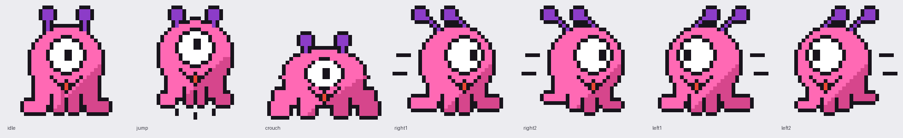

# Super POPO Land

ピンクのひとつ目モンスター「ポポ」が冒険する、8bit 風の横スクロールアクションゲームです。
ブラウザだけで動き、ビルドやインストールは不要です。



## あそびかた

| 操作 | キーボード | タッチ | ゲームパッド |
| --- | --- | --- | --- |
| 移動 | `←` `→` / `A` `D` | ◀ ▶ | 十字キー / スティック |
| しゃがむ | `↓` / `S` | ▼ | 下 |
| ジャンプ（長押しで高く） | `Space` / `Z` | A | A / B |
| ダッシュ | `X` / `Shift` | B | X / Y / RT |
| ポーズ | `Enter` / `Esc` / `P` | II | START |
| 音のオンオフ | `M` | 右上のボタン | – |

- **全 4 ステージ**: 1-1 ポポの丘 / 1-2 クリスタル洞窟 / 1-3 くものうえ / 1-4 ポポ城
- **ポポベリー**（むらさきの実）: アンテナが金色になり、1 回だけダメージをふせぐ
- **スター**: 10 秒間無敵。さわった敵をやっつける
- **敵**: グミ（ふめる）、カラ（ふむと甲羅になって蹴れる）、パタ（飛ぶ・ふめる）、トゲ（ふめない！）
- コイン 100 枚で 1UP。中間フラッグ（チェックポイント）あり。ゲームオーバー後は同じステージからコンティニューできます
- ハイスコアはブラウザに保存されます

## 起動方法

### ローカル（第一段階）

`index.html` をブラウザで開くだけで遊べます（`file://` のままで動作します）。

ローカルサーバーを使う場合:

```bash
python3 -m http.server 8000
# http://localhost:8000 を開く
```

### オンライン公開（第二段階）

**GitHub Pages（推奨・無料）**

`.github/workflows/pages.yml` が入っているので、`main` ブランチに push すると自動で公開されます。
初回だけリポジトリで次の設定をしてください。

1. GitHub のリポジトリ → **Settings** → **Pages**
2. **Build and deployment** の **Source** を **GitHub Actions** にする
3. `main` に push（または Actions タブから「Deploy to GitHub Pages」を手動実行）

公開先: `https://<ユーザー名>.github.io/Super-POPO-Land/`

> 無料プランの GitHub Pages は **公開リポジトリ** が対象です（非公開リポジトリで使うには有料プランが必要）。

**1 ファイル版**

```bash
python3 tools/build_single.py   # → dist/super-popo-land.html
```

CSS・JS・アイコンをすべて埋め込んだ 1 つの HTML ができます。Claude の成果物 (Artifact) や、
Netlify Drop などの静的ホスティングにそのまま置けます。

## キャラクター画像の 8bit 化

ポポのドット絵は `assets/popo_sheet.png`（32×32 px × 7 コマ: idle / jump / crouch / right1 / right2 / left1 / left2）から
`tools/make_sprites.py` で変換しています。

```bash
python3 tools/make_sprites.py            # assets/popo_sheet.png → js/sprites.js
```

- 拡大済みの画像でも 1 ドットの大きさを自動検出して 32 px に縮小（例: `assets/popo_original.png` は 10 倍拡大）
- 最大 8 色のパレットに減色し、パレット番号の文字列として JS に書き出し（`file://` でも読み込める）
- 走りコマのスピード線を取り除いた「歩き」コマも自動生成（ダッシュ中だけスピード線付きのコマを表示）
- パレット番号なので、ゲーム中に色の差し替えができます（ポポベリーで金色アンテナ、スター中は虹色）

キャラを描き直したときは `assets/popo_sheet.png` を置き換えて上のコマンドを実行するだけで反映されます。

## ファイル構成

```
index.html          画面とタッチボタン
style.css           見た目
js/sprites.js       ポポのドット絵データ（自動生成）
js/art.js           タイル・敵・アイテム・背景・ドットフォントをコードで生成
js/audio.js         効果音と BGM（WebAudio のチップチューン、すべてオリジナル曲）
js/input.js         キーボード / タッチ / ゲームパッド入力
js/levels.js        ステージデータ（ここを編集すればステージを作れます）
js/game.js          ゲーム本体（物理・敵・アイテム・画面遷移・描画）
tools/              スプライト変換・1 ファイル版ビルド
assets/             元画像・アイコン
```

## ステージの作り方

`js/levels.js` の各 `level*` 関数でブロックや敵を配置しています（座標はタイル単位、縦は 0〜13 行、地面は 12 行目）。

```js
b.ground(0, 40);          // 0〜40 列に地面
b.row(20, 8, "B?BPB");    // B=レンガ ?=コイン P=ポポベリー S=スター b=連続コイン X=かたいブロック
b.pipe(29, 10);           // 土管（上端の行）
b.enemy("gumi", 24);      // 敵: gumi / kara / toge / pata
b.lift(81, 9, 3, "x", 5); // 動く足場（x: 横、y: 縦）
b.checkpoint(97);         // 中間フラッグ
b.goal(200);              // ゴールの旗
```
